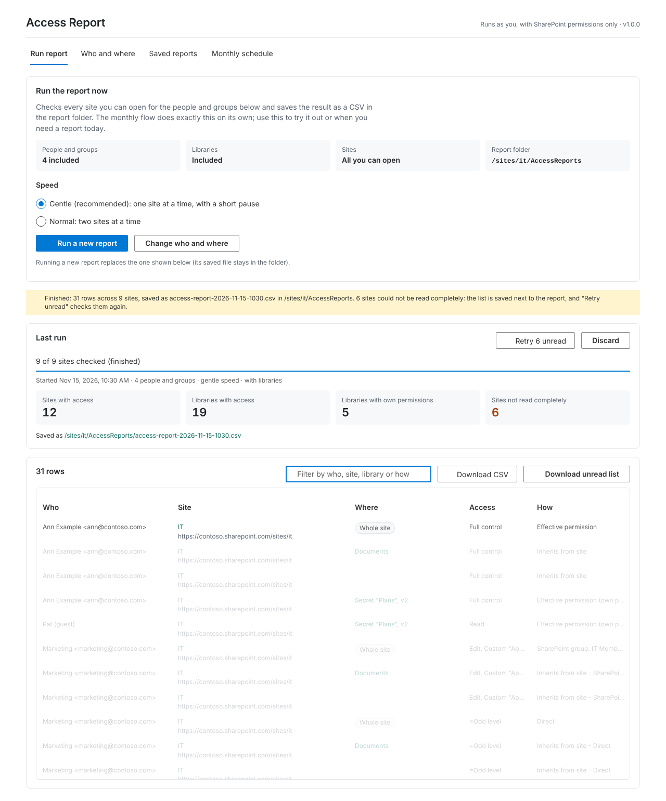
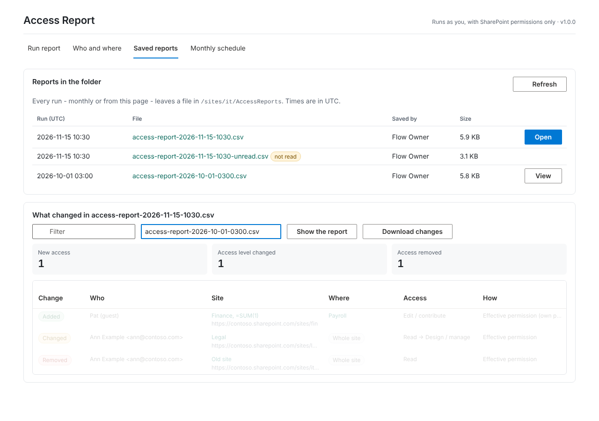

# Access Report

Every site, **subsite** and library that chosen **people and groups** can reach - with the
access level and how they get it - saved as a CSV in a SharePoint folder. Run it from the page,
let the included **Power Automate flow** run it on the first of every month, or run the
included **PowerShell** script.

It is the *Access report* of the SharePoint Admin Center solution, taken out into its own
package and made schedulable.

- **No extra permissions.** The web part uses SharePoint REST as the signed-in user. The package
  requests no API permissions: nothing to approve under *API access*, no app registration, no
  Microsoft Graph.
- **No premium connectors.** The flow uses one action type, the standard SharePoint connector's
  *Send an HTTP request to SharePoint*, and runs as the owner of its connection.
- **One place to configure.** Who to report on, where to look and where to save are set on the
  page and stored in the site; the flow reads them each time it runs.



## What is in the box

| File | What it is |
| --- | --- |
| `releases/access-report-webpart.sppkg` | The SPFx web part (SPFx 1.18.2) |
| `releases/AccessReport-monthly-flow.zip` | The flow, for *My flows > Import > Import Package (Legacy)* |
| `releases/AccessReportMonthly_1_0_0_0.zip` | The same flow as an unmanaged solution, for *Solutions > Import solution* |
| `powershell/Get-AccessReport.ps1` | The same report from PowerShell (PnP.PowerShell) |

The two flow packages in `releases/` carry a placeholder site address. The web part's **Monthly
schedule** tab downloads the same packages with your site's address already filled in - use
those.

## Set-up

1. Upload `access-report-webpart.sppkg` to the app catalog and deploy it.
2. Add the **Access Report** web part to a page (a single-part app page works well) in the site
   that should hold the reports. Restrict that site, or at least the report folder: the reports
   say who can reach what.
3. Press **Set up** (you need to be an owner of the site). It creates two lists
   (`Lists/AccessReportSubjects`, `Lists/AccessReportSettings`) and a library (`AccessReports`).
4. **Who and where**: find people, security groups and Microsoft 365 groups (the search is
   SharePoint's own people picker), or add *Everyone except external users* / *Everyone*.
   Choose whether libraries are included, an optional site filter, and the report folder.
5. **Run report** to try it. The file appears in the folder and under **Saved reports**.
6. **Monthly schedule**: download the flow package and import it in Power Automate as the
   account the report should run as; switch the flow on and press *Run* once to test it.

## What the report says

`access-report-yyyy-MM-dd-HHmm.csv` (UTC), one row per place with access:

| Column | |
| --- | --- |
| Who | The name given to the person or group; `(owners)` marks a Microsoft 365 group's owners |
| Site URL, Site title | The site or subsite the row is about |
| Object, Name, URL | `Site` (a site collection's top-level site), `Subsite`, or `Library` with its name and address |
| Access | People: *Full control*, *Design / manage*, *Edit / contribute* or *Read*. Groups: the permission level names of the grant |
| How | People: *Effective permission* (SharePoint's own answer: direct grants, SharePoint groups, Entra ID groups, Everyone claims, site admin rights). Groups: *Direct*, *SharePoint group: ...*, *Site collection administrator* |
| Own permissions | `Yes` when the library (or the subsite) does not inherit from its parent |
| Site collection | The site collection the row belongs to |

Anything that could not be read (a site the account cannot open, a request that failed) goes
into a second file, `...-unread.csv`, with the step, the HTTP status and the error - nothing is
skipped silently.

**Saved reports** opens any report and compares it with an earlier one: access that is new,
access that is gone, and levels that changed.



## Subsites

Every site collection is walked down to its last level: `_api/web/webs` lists each web's
direct subsites (one request per web), breadth first, and every subsite is checked like a site -
for each person and group, and with its libraries. A subsite that inherits permissions still
gets its own rows, so a report always says where someone can get in, not just where the
permission was granted. A subsite that cannot be listed or opened is in the unread file.

## Who can see what

The report covers the sites the *running account* can open: you, for **Run report**; the owner
of the flow's SharePoint connection, for the monthly run. Reading another person's permissions
on a site needs owner or site collection administrator rights there, so for a tenant-wide
report run the flow as an account that is a site collection administrator of the sites to
cover. OneDrive sites are left out.

Limits worth knowing:

- People get the built-in levels by their mask; Limited Access alone is not reported as access.
- Groups are reported at site and library level from the role assignments; folders and files
  with their own permissions, and sharing links, are not walked.
- A group nested inside another Entra ID group is not expanded (that needs the directory).

## How the monthly flow works

`Recurrence` (first of the month, 03:00 UTC) -> read settings and subjects from the site ->
list the sites through search (pages of 500, by start row, up to 50,000 sites; three one-row probes first pick a sort order the tenant's search accepts - Created, else LastModifiedTime, else none - and if search refuses all three, the reason is written to the note the web part shows) -> for each site: one request per person,
one per group (more only where the group is known to the site), the libraries once -> write the
CSV into the folder, the unread list if there is one, and a "Finished ..." note the web part
shows.

- Loops run one item at a time: gentle on SharePoint, and rows come out in a stable order.
- A failed request is recorded and the run carries on; the report is saved even if the scan
  stopped part-way, and the run is then marked failed.
- Cost: about 10 actions per site collection (listing its subsites included) and 8 more per subsite, plus 2 per person (4 with libraries) and 3 per group, for every site and subsite. A few
  hundred sites finish within the hour. Large tenants take hours and count against the
  owner's daily Power Platform request allowance: narrow with the site filter, leave libraries
  out, or run under an account with a Power Automate licence.

`flow/definition.json` is the generated definition, for reading.

## PowerShell

`powershell/Get-AccessReport.ps1` makes the same report: the same REST calls in the same order
as the web part, the same file format, subsites included.

```powershell
Install-Module PnP.PowerShell -Scope CurrentUser        # PowerShell 7.2 or later

# The report the monthly flow makes: reads who and where from the web part's site and uploads there.
./Get-AccessReport.ps1 -HomeSiteUrl https://contoso.sharepoint.com/sites/it -ClientId <app id>

# A one-off, local file only.
./Get-AccessReport.ps1 -HomeSiteUrl https://contoso.sharepoint.com/sites/it -ClientId <app id> `
    -Subject 'Ann=ann@contoso.com','Auditors=c:0t.c|tenant|<group object id>' `
    -SiteUrl https://contoso.sharepoint.com/sites/fin -IncludeLibraries $false -NoUpload
```

**It needs an app registration.** PnP.PowerShell signs in through an Entra ID app of your own
(since September 2024): create one once with `Register-PnPEntraIDAppForInteractiveLogin` and an
admin consents to it. That is the one extra requirement of this route; the web part and the flow
need none. `Get-Help ./Get-AccessReport.ps1 -Full` lists every parameter.

## How it was tested

`npm test` (Node 18):

- **Unit tests** (30, on both ES2019 and ES5 output): request pacing and retry, permission
  levels against the built-in masks, the CSV format, set-up (fresh, repeated, half-finished),
  site paging and its fallback, subsites (breadth first, every level), stop / resume / pause-on-errors / retry of a run, comparison.
- **Flow tests** (20): the flow definition is *executed* by a simulator of the workflow
  language (`tests/wdl.js`) against a fake tenant (`tests/fakeTenant.js`), and the file it
  saves must equal, byte for byte, the file the web part's code produces from the same tenant -
  across people, guests, security and Microsoft 365 groups, Everyone claims, denied sites,
  failing requests, subsites two levels down (own permissions, inherited, denied, unlistable), odd titles, 1,203 sites over three search pages, search refusing sort orders, and more. The simulator
  is stricter than the service where the service is not certain: `if` gets both branches
  evaluated, integers must fit 32 bits, null and out-of-range arguments throw. The permission
  level expression is checked against the TypeScript one on 20,000 random masks. Both packages
  are unzipped and their ids, references and XML checked.
- The suite was mutation-tested with 25 deliberate faults in the flow. Four slipped through at first; the tests and the fake tenant were tightened until each was caught.

`node tests/ui.test.js` (after `npm run build` and `node tests/harness/build.js`; needs
Playwright) drives the real UI in Chromium on the fake tenant: set-up, adding people, a run,
stop / reload / resume, saved reports and comparison, and that the flow packages the page
downloads are exactly the ones built for that site.

**Not run: the PowerShell script.** PowerShell was not available where it was written. It
mirrors the tested web part code line for line, but its first run is its test: try it on one
site collection with `-SiteUrl ... -NoUpload` and compare the file with one from **Run report**.

**Not tested: a real tenant.** There was none available. The REST calls are the documented
ones and the flow's expressions use only documented functions, but the first import and the
first run in your tenant are the real test. If the legacy package does not import, try the
solution, and the other way round; run the flow once with *Run* and compare its file with one
from **Run report**.

## Build

```
nvm use 18
npm install
npm test
npm run build && npm run package-solution   # sharepoint/solution/access-report-webpart.sppkg
npm run build:flow                          # releases/*.zip and flow/definition.json
```
