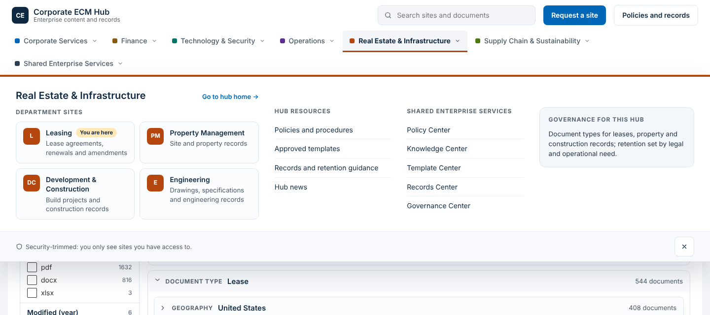
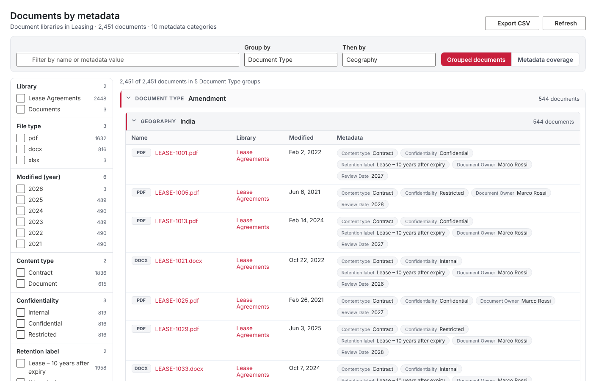
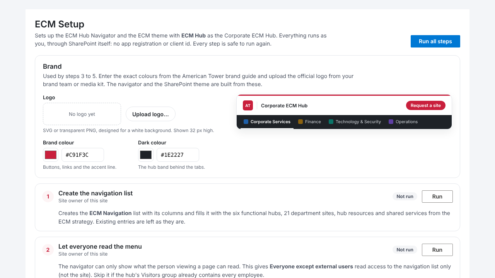
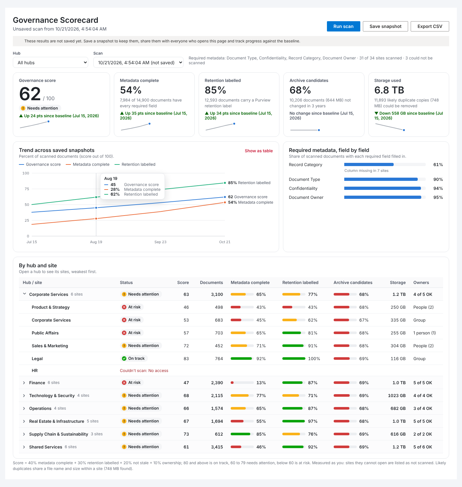

# ECM Foundation (module 1)

The first module of the custom SharePoint layer for the ECM strategy. It puts
the hub-and-spoke information architecture in front of users and makes
document metadata visible:

| Component | Type | What it does |
| --- | --- | --- |
| **Brand and theme** | SharePoint theme + brand settings | Your logo, brand colour and dark colour drive both the navigator and an **American Tower ECM** SharePoint theme generated from them, so SharePoint's own chrome and the ECM components always match. |
| **ECM Hub Navigator** | Application customizer | Brand bar, search, hub tabs with a mega menu, breadcrumb and site classification on every page. Security-trimmed. Driven by one SharePoint list, so governance changes the menu without a redeploy. |
| **ECM Setup** | Web part | One-time setup from a page on the Corporate ECM Hub: creates and seeds the navigation list, registers and applies the theme, points the navigator at the hub, and checks every link. |
| **Governance Scorecard** | Web part | Module 2. Measures the pilot's value targets across every site in the navigation: metadata completeness, retention labelling, archive candidates, storage and duplicates, and ownership. Shown per hub and site, with saved snapshots, a baseline and a trend. |
| **Metadata Explorer** | Web part | Every document in the site's libraries (or a hub / the tenant through search), grouped by any metadata category with a second-level "then by", facet filters, links to each file, a metadata coverage view and CSV export. |

Everything runs on the current user's SharePoint session through
SharePoint REST and Search: **no Entra ID app registration, client id or API
permission is needed**, including for setup. The **ECM Setup** web part does
the one-time configuration from the browser.





## Modules in the ECM solution

| # | Module | Status |
| --- | --- | --- |
| 1 | **ECM Foundation**: theme, Hub Navigator, Metadata Explorer, ECM Setup | In this package |
| 2 | **Governance Scorecard**: metadata, retention labelling, stale content, storage and ownership per hub and site (pilot value targets) | In this package |
| 3 | Site Request and provisioning: standard department template, `ATC-SP-{Dept}-*` Entra groups, sensitive-site flow | Planned |
| 4 | Document Compliance Panel: label, owner, review date and lifecycle state on each document | Planned |
| 5 | Content Health: duplicate, stale and ownerless content before migration (extends [`filetype-analyser`](../filetype-analyser)) | Planned |

## Deploy (no app registration or client id needed)

Everything in this package calls SharePoint REST as the signed-in person, so
it declares **no API permission requests** and needs no Entra ID app
registration. (Module 3, which creates Entra ID groups, will be the first to
request Microsoft Graph access. That request will appear in SharePoint admin
center → Advanced → API access, for a Global or Privileged Role Administrator
to approve.)

1. **Get the package.** Use the pre-built [`releases/ecm-foundation.sppkg`](releases/ecm-foundation.sppkg),
   or build it yourself with Node 18 (as SPFx 1.18.2 requires):

   ```bash
   npm install
   npm run build
   npm run package-solution   # -> sharepoint/solution/ecm-foundation.sppkg
   ```

2. **Upload it to the tenant app catalog** (SharePoint admin center → More features → Apps).
   When asked, tick **"Enable this app and add it to all sites"**. This adds the ECM Hub Navigator
   to every site and makes the web parts available everywhere.

3. **Run ECM Setup on the Corporate ECM Hub.** Create a page on the hub site (for example
   *ECM Setup*) and add the **ECM Setup** web part (group "ECM"). Fill in the **Brand**
   section first: upload the logo and check the colours (see [Brand](#brand)). Then select
   **Run all steps**. Each step reports what it did and is safe to run again:

   | Step | What it does | Who can run it |
   | --- | --- | --- |
   | 1. Create the navigation list | Creates **ECM Navigation** with its columns and fills it with the 6 functional hubs, 21 department sites, hub resources and 6 shared services from the strategy. Existing entries are never changed. | Owner of the hub site |
   | 2. Let everyone read the menu | Gives *Everyone except external users* read access to that list only. | Owner of the hub site |
   | 3. Register the ECM theme | Adds **American Tower ECM**, generated from your brand colour, to "Change the look" for all sites. Optional. | SharePoint administrator |
   | 4. Apply the ECM theme | Applies that theme to the hub and every site in the menu. Sites you don't own are skipped and reported. | Owner of each site |
   | 5. Point the navigator at this hub | Writes this site's address, the hub title, the logo and the brand colours into the navigator's settings in the Tenant Wide Extensions list. Adds the entry if it is missing. | App catalog owner (SharePoint administrator) |
   | 6. Check the links | Checks every entry in the menu (sites, pages and libraries) and lists the ones that don't exist. | Anyone |

   The seeded site URLs follow `/sites/<name>` (`/sites/leasing`, `/sites/hr`, …). Step 6 shows
   which ones don't match your tenant. Correct those in the list (the step 1 card links to it)
   and the menu updates for everyone within the cache time.

   If you aren't a SharePoint administrator, run steps 1, 2, 4 and 6 yourself. Then ask an
   administrator either to open the same page and run steps 3 and 5, or to set
   `configSiteUrl` by hand in the app catalog's Tenant Wide Extensions list.

To limit the navigator to some sites, use the Tenant Wide Extensions entry's site
template filter, or disable that entry.

## ECM Hub Navigator

### The navigation list

| Column | Internal name | Use |
| --- | --- | --- |
| Title | `Title` | Text shown in the menu |
| Type | `EcmNavType` | `Hub`, `Department site`, `Shared service`, `Hub resource` or `Header link` |
| Parent hub | `EcmParentHub` | Hub title, for department sites and hub resources |
| URL | `EcmUrl` | Where the entry links to |
| Description | `EcmDescription` | Line under a site name; on a hub, the governance note in the menu |
| Order | `EcmOrder` | Sort order within its group |
| Restricted | `EcmRestricted` | Show only to people who can open the site |
| Active | `EcmActive` | Untick to hide without deleting |
| Hub colour | `EcmColor` | Optional hex accent for a hub (defaults follow the strategy deck) |

The first **Header link** is shown as the primary button (the seed makes this
"Request a site", pointing at `SitePages/Request-a-site.aspx` on the hub). Create that page, or
change the link to your request form. The site request form itself comes in Module 3.

**Everyone must be able to read this list.** If they can't, the navigator shows
"Navigation could not be loaded". ECM Setup step 2 takes care of this.

### How it behaves

- **Fast.** The menu is cached in the browser for `cacheMinutes` (30 by default). While the cache is
  fresh, a page view makes no requests at all. After that, the next page view reloads the menu
  once. Changes in the list therefore reach everyone within `cacheMinutes`. The bundle is about
  55 KB because it uses no Fluent UI.
- **Hidden until it's set up.** Deploying the package registers the navigator on every site before
  ECM Setup has created the list. Until it can read the list, the navigator shows nothing at all,
  not an error, and retries every few minutes. The reason is written to the browser console
  (`[ECM Hub Navigator] Hidden: …`).
- **Security-trimmed.** Rows marked *Restricted* are kept only if a search query (which SharePoint
  security-trims) returns that site for the current user. One small query covers every restricted
  site. If it fails, restricted rows stay hidden (fail closed). The result is cached per session.
  Unrestricted rows show to everyone, so leave a site unrestricted only if everyone can open it.
- **Knows where you are.** It matches the current site against the list. A site that isn't listed
  but is associated with a hub still gets that hub's breadcrumb, through SharePoint's hub association.
- **Works on phones.** Below 768 px the tabs become a drawer with an accordion per hub, opened on
  the current hub. Escape, clicking outside, following a link and moving to another page all close
  the menu.

### Brand

The **Brand** section at the top of ECM Setup sets the look everywhere:

- **Logo**: upload the official logo (SVG or transparent PNG, made for a white
  background) from your brand team or the corporate media kit. ECM Setup stores it
  as `SiteAssets/ecm-logo.*` on the hub and, when step 2 is included, lets
  *Everyone except external users* read that one file. Without a logo, the navigator
  shows a text badge ("AT") in the brand colour.
- **Brand colour**: buttons, links, the accent line, the "you are here" tag and
  the SharePoint theme. The default is **#C91F3C** (cardinal red).
- **Dark colour**: the hub band behind the tabs. The default is **#1E2227** (charcoal).

The defaults follow American Tower's public identity: a red mark with charcoal type on
white. They come from public brand listings, not the official brand guide, so
**check them against the guide** and enter the exact values. A live preview shows the
result before you run any step. Steps 3 and 4 then build the SharePoint theme from
the brand colour (all 26 theme colours), and step 5 stores the brand in the navigator's
settings, where ECM Setup also reads it back next time.



Hubs keep their own accent colours (blue, ochre, teal, violet, burnt orange, olive,
slate). Red is reserved for the brand, so no hub uses it.

### Properties

ECM Setup step 5 writes these. You can also edit them by hand in the app catalog's Tenant Wide Extensions list:

```json
{
  "configSiteUrl": "/sites/ecm-hub",
  "listTitle": "ECM Navigation",
  "cacheMinutes": 30,
  "homeTitle": "Corporate ECM Hub",
  "brandBadge": "AT",
  "logoUrl": "/sites/ecm-hub/SiteAssets/ecm-logo.svg",
  "brandPrimary": "#C91F3C",
  "brandDark": "#1E2227",
  "searchUrl": "https://contoso.sharepoint.com/_layouts/15/search.aspx/?q={q}"
}
```

Only `configSiteUrl` is required.

## Governance Scorecard

Module 2 ships in the same package, so updating stays one upload of
`ecm-foundation.sppkg`. Add **Governance Scorecard** (group "ECM") to a page on the
Corporate ECM Hub, for example an *ECM Scorecard* page.



### What it measures

**Run scan** reads every site in the ECM Navigation list: hubs, department sites and
shared services. For each site it reads the document libraries (up to *Documents read per
site*, 5,000 by default), the site's storage and its owners group:

| Measure | How it is counted | Strategy link |
| --- | --- | --- |
| **Metadata complete** | Documents with **every** required field filled in. Required fields are set in the web part (default: Document Type, Confidentiality, Record Category, Document Owner) and matched by column name or internal name. A site without one of the columns counts all its documents as missing it, and is flagged "column missing". | Target 1: metadata and ownership coverage |
| **Retention labelled** | Documents with a Purview retention label (`_ComplianceTag`). | Target 3: retention labelling |
| **Archive candidates** | Documents not changed in *N* years (default 3), with their size. | Target 2: active storage reduction |
| **Storage** | Site storage as SharePoint reports it, plus likely duplicate copies (same file name and size within a site) and their size. | Target 2 |
| **Ownership** | The site's owners group holds a group (the `ATC-SP-{Dept}-Owners` Entra ID group, or a Microsoft 365 group's owners), or at least two people. One person is flagged as a risk. | Permission model |

The **governance score** (0 to 100) is 40% metadata complete + 30% retention labelled +
20% not stale + 10% ownership. A measure with no data (for example, owners you can't read)
is left out and the weights are rebalanced. **80 and above** is *On track*, **60 to 79**
is *Needs attention* and **below 60** is *At risk*. Status always has an icon and a label,
never colour alone.

### Snapshots, baseline and trend

A scan shows its results immediately. **Save snapshot** stores them in an
**ECM Scorecard Snapshots** list on the hub, which is created on the first save and needs
edit rights on the hub. That list has one item per scan, with the headline numbers as
columns and each site's counts as JSON. Everyone who opens the page then sees the latest
snapshot without scanning. The **first saved snapshot is the baseline**: every tile shows
its change since then, and the trend chart plots score, metadata and labelling across all
snapshots. Use **Hub** to scope every number and the trend to one hub, **Scan** to view an
earlier snapshot, and **Export CSV** for one row per site with every measure. Each chart
has a table view.

### Good to know

- **It measures what the person scanning can open.** Sites they can't open are listed as
  "Couldn't scan: No access", not left out. Have a SharePoint administrator, or someone
  with access to every ECM site, run the scans you save.
- **Large sites are sampled.** Above the per-site limit, a site is measured on its first
  documents and marked *Sampled*. Raise the limit for exact figures; scans take longer.
- **Subsites aren't scanned**, only each site's top-level libraries. This matches the
  flat hub-and-spoke design.
- Scans run in the browser, two sites at a time. Expect a few minutes for a full scan of
  the seeded 34 sites. Scheduled scans (for example, weekly through Power Automate)
  could be added later.

## Metadata Explorer

Add **Metadata Explorer** (group "ECM") to any page. It has two sources:

### Document libraries in this site (default, no setup)

The web part reads every document library on the site. You can limit it to the libraries
you list in the settings. Every custom column becomes a category:

- choice, managed metadata, person, lookup, text, yes/no, number, date (grouped by year);
- plus **Content type**, **Retention label**, **Library**, **File type** and **Modified (year)**.

Values are the labels people see, so taxonomy terms appear as their names.
Libraries over the 5,000-item view threshold are paged safely, and folders are skipped.

### Search index (site, hub or whole organisation)

Use this for a hub-wide or tenant-wide view. Each category is a managed property,
listed one per line as `Title|ManagedProperty`. Map the ECM core columns in the search
schema first (SharePoint admin center → Search → Manage Search Schema), for example:

| Category | Crawled property | Managed property |
| --- | --- | --- |
| Document Type | `ows_taxId_DocumentType` (or `ows_DocumentType`) | `RefinableString00` |
| Department | `ows_taxId_Department` | `RefinableString01` |
| Record Category | `ows_RecordCategory` | `RefinableString02` |
| Confidentiality | `ows_Confidentiality` | `RefinableString03` |
| Status | `ows_Status` | `RefinableString04` |

Both plain and taxonomy (`L0|#0guid|Label`) values are read, and multi-value properties are
split on `;`. Hub scope uses the page's hub (`DepartmentId`). On a site that has no hub, it
falls back to the current site.

### Using it

- **Group by / Then by**: any category, two levels deep. A document with several values
  (multi-value columns) appears under each of them. "(No value)" groups show the metadata
  gaps that need fixing.
- **Facets**: tick values to filter. Filters combine with AND across categories and OR within one.
  Each facet's counts reflect the other filters.
- **Metadata coverage**: the share of documents with each category filled in. This is the
  pilot's "metadata and ownership coverage" measure, and it follows the current filters.
- **Export CSV**: the filtered documents with every category, for offline review.
- File names open in the browser for Office files and directly for other types.

**Maximum documents** (5,000 by default) caps how much the web part loads in one go.
A warning appears when there are more.

## Project layout

```
src/
  common/                 shared by every ECM component
    theme/ecmTheme.ts     palette, hub colours, --ecm-* CSS variables, the SharePoint theme
    services/SpRestClient.ts  REST + search with throttling retry
    services/ListHelper.ts    create lists and columns, add items (setup and snapshots)
  extensions/ecmHubNavigator/
    EcmHubNavigatorApplicationCustomizer.ts
    services/NavigationService.ts   list load, cache, security trimming, location
    components/HubNavigator.tsx     bar, mega menu, drawer, breadcrumb
  webparts/ecmSetup/
    data/navigationSeed.ts          the strategy's hubs, departments and services
    services/SetupService.ts        list, permissions, theme, navigator settings, link check
  webparts/governanceScorecard/
    services/ScorecardScanner.ts    sites from the navigation list, libraries, storage, owners
    services/metrics.ts             counting, aggregation, weighted score, status
    services/SnapshotStore.ts       ECM Scorecard Snapshots list (save / load)
    components/                     KPI tiles, trend chart, field coverage, hub table
  webparts/metadataExplorer/
    services/LibrariesSource.ts     RenderListDataAsStream per library
    services/SearchSource.ts        search query, managed property mapping
    services/grouping.ts            filters, facets, groups, coverage, CSV
    components/                     explorer, facets, groups, tables
sharepoint/assets/        ClientSideInstance.xml (tenant-wide registration)
```
