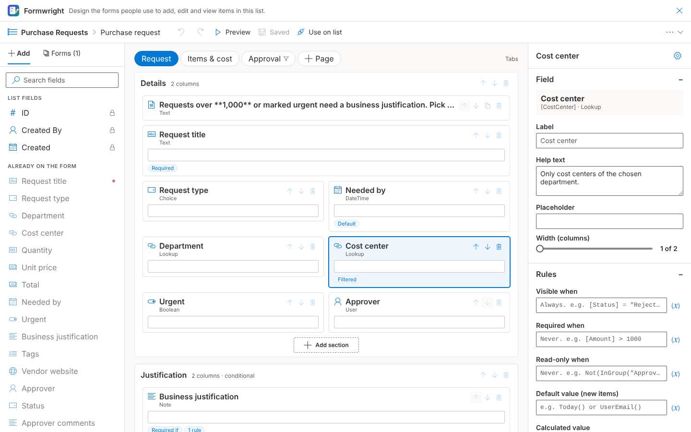
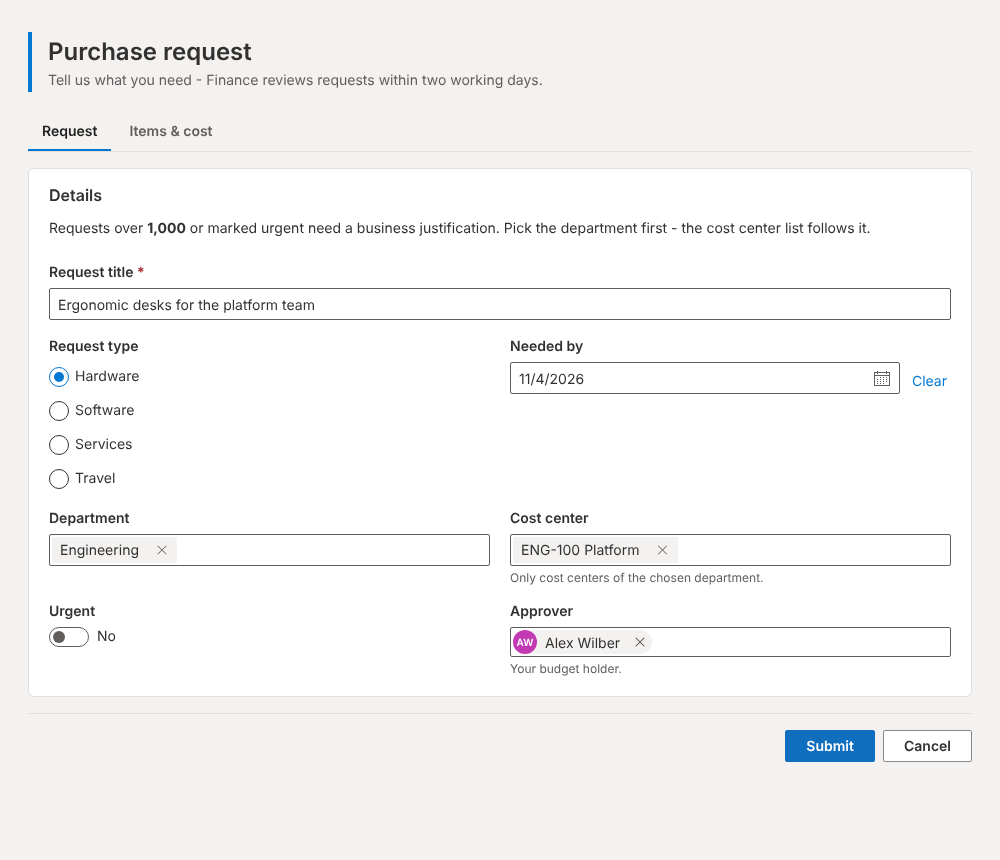
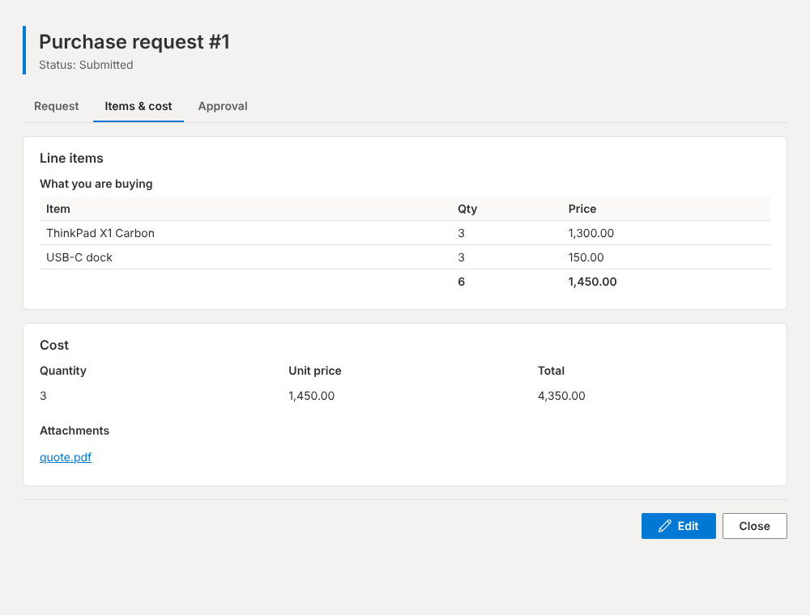

# Formwright

**Custom SharePoint list forms, designed in the browser and stored as JSON.**<br clear="left">

Deploy one `.sppkg` and every list gets a **Customize forms** button. It
opens a drag-and-drop designer, and the forms you design replace the list's
own New / Edit / Display forms. There's also a web part that puts a form on
any page. No Azure app registration and no separate app per list to manage.

**[Download formwright.sppkg](releases/formwright.sppkg)** (version 1.2.0)


<sub>The designer, opened from "Customize forms" on a sample "Purchase Requests" list. Fictional data.</sub>

Formwright covers what teams usually reach for Plumsail Forms or a
customised Power Apps list form to get: layouts with sections, tabs and
wizards; fields that show, hide, become required or read-only based on other
fields; calculated and default values; validation; cascading lookups;
different forms for different groups; approval buttons; and child items
edited inline. Rules are written in a small Excel / Power Fx style expression
language. No custom JavaScript runs, so a form definition can't execute code.

| New item, as the requester | Existing item, as an approver |
| --- | --- |
|  |  |

## What's in the package

| Component | What it does |
| --- | --- |
| **Customize forms** (list command) | A button in the command bar of every list and library, shown to people who can manage the list. It opens the designer full-screen over the list: drag fields and elements onto sections, set rules, preview with real items, save, and switch the list over to Formwright. |
| **Formwright form customizer** (extension) | Replaces the list's New, Edit and Display forms. It picks the right form for the item and the person and renders it. |
| **Formwright - Form** (web part) | Puts a form on any page, for intake forms, request portals or a "submit an idea" page. `?itemId=12` on the page URL opens item 12 instead. |

## Features

**Layout**
- Sections with 1 to 4 columns. Each control spans 1 to all columns, and
  everything stacks to one column on phones.
- Single page, **tabs** or **wizard** (step by step, validating each step
  before Next).
- Collapsible sections, headings, rich text (bold, italics, links, bullets),
  images, dividers and spacers.
- Labels above or beside fields, maximum width, and an accent colour. The
  site theme is used by default.

**Fields**
- Every common column type: single line, multi-line and enhanced rich text,
  number, currency, percentage, choice (drop-down or radio, with fill-in),
  multi-choice (checkboxes or drop-down), yes/no (toggle or checkbox),
  date and date-time, lookup and multi-lookup, person or group (single and
  multi), hyperlink and picture, managed metadata, and attachments.
- Calculated, ID, Created and Created By columns are shown read-only.
- Labels, help text and placeholders can be overridden per form.

**Rules** (expressions, see [the reference](#expression-reference))
- *Visible when*, *Required when* and *Read-only when* on fields, sections,
  pages and buttons.
- *Default value* for new items, e.g. `DateAdd(Today(), 14)` or `UserEmail()`.
- *Calculated value*, recalculated as the person types and saved with the
  item, e.g. `[Quantity] * [UnitPrice]`.
- Validation rules per field (`[EndDate] >= [StartDate]`) and for the whole
  form. Required fields, maximum length and min / max from the list are
  checked automatically.
- Text with `{{ expression }}` placeholders in titles, headings, text, links
  and redirects, e.g. `Purchase request #{{ItemId()}}`.

**Data**
- **Cascading lookups**: only offer Cost Centers whose Department matches the
  Department chosen on the form. You can also add your own OData filter with
  form values.
- **Related items**: edit child rows of another list inline, such as order
  lines or expense lines, linked by a lookup column. Rows for a new item are
  created right after the item is saved. Number columns get totals.
- **Buttons** that set fields and save, e.g. *Approve* sets
  `Status = "Approved"` and `ApprovedOn = Now()`. They also work on the
  display form, for one-click approvals. Other buttons open a link, print or
  close the form.
- *Set fields on every save*, e.g. `Status = If(FormMode() = "New", "Submitted", [Status])`.
- **Only changed fields are written**, so a form never overwrites a column it
  didn't change (another form, a flow or a person may own it).
- **Conflict detection**: if someone else saved the item after you opened it,
  your save is refused and you're told to reload, instead of silently
  overwriting their change.
- **Safe retries**: if a save fails part-way (say, an attachment upload or one
  related row), pressing Save again picks up where it stopped. It never
  creates the item twice or repeats uploads.
- **SharePoint defaults are kept**: column defaults, including managed
  metadata defaults, appear on new items. Lookup and person columns left
  blank aren't sent, so SharePoint can apply its own default.

**Forms per audience**
- Any number of forms per list. Each one targets modes (New / Edit /
  Display), SharePoint groups and content types. The first match wins, so an
  "Approvers" form can sit above an "Everyone" form. A list with no matching
  form gets an automatic one with every field.

**Designer**
- Drag and drop from the field and element palette, or click to add to the
  selected section. Drag controls to reorder them, onto another section, or
  onto a page tab.
- Undo / redo (Ctrl+Z / Ctrl+Y), save with Ctrl+S, and a warning before
  leaving with unsaved changes.
- Expressions are checked as you type: syntax errors, unknown functions and
  misspelt field names. A reference panel inserts fields and functions at the
  cursor.
- **Preview** in New, Edit or Display mode, optionally against a real item by
  ID. Rules run with your own groups. Nothing is saved in preview.
- Export / import forms as JSON, to copy them between sites or keep them in
  source control. See [`samples/`](samples/).
- **Use on list** switches a list's forms to Formwright (or back) in one
  click.

## Coming from Power Apps or Plumsail

| You used | In Formwright |
| --- | --- |
| Power Apps `DataCard.Visible: If(...)` | Field / section **Visible when** `[Status] = "Rejected"` |
| `DataCard.Required`, `DisplayMode` | **Required when**, **Read-only when** |
| `Default` / `Update` formulas | **Default value**, **Calculated value**, **Set fields on every save** |
| `Patch` behind an Approve button | **Button** with *Set fields before saving* |
| `User().Email`, `IsBlank`, `DateAdd`, `If`, `Switch`, `Text` | Same names: `UserEmail()`, `IsBlank`, `DateAdd`, `If`, `Switch`, `Text` |
| Filtered `Choices()` for a lookup | **Cascading filter** or **Custom OData filter** |
| A gallery of child records | **Related items** |
| Plumsail custom JavaScript (`fd.field(...).hidden = ...`) | Expressions on the field: no code needed for show / hide / require / disable / set |
| Plumsail tabs, wizard, accordion | Form **Layout**: tabs or wizard; collapsible sections |
| Plumsail "List or Library" control | **Related items** |
| Plumsail forms per group / content type | Several forms with **audience** and **content types** |

Things Formwright doesn't do: custom JavaScript, connectors to systems
outside SharePoint, offline use, and Plumsail's public (anonymous) forms.
Use Power Automate, triggered by the list, for anything that should happen
after an item is saved.

## Upgrading from Form Studio

Formwright was called Form Studio before version 1.2. Upload
`formwright.sppkg` over the old package: the solution and component ids are
unchanged, so it upgrades in place, and lists already switched over keep
working. Forms saved by Form Studio (in `SiteAssets/FormStudio`) still load.
The next save writes them to `SiteAssets/Formwright`.

## Get started

1. Download [`releases/formwright.sppkg`](releases/formwright.sppkg).
2. Upload it to your **tenant** App Catalog and choose **Enable this app and
   add it to all sites**. Every custom list and document library then shows
   **Customize forms** in its command bar. (Or upload it without that option
   and add the app only to the sites that need it. The button then appears on
   those sites' lists. Don't do both for the same site, or the button appears
   twice.)
3. Open a list and click **Customize forms**. The button appears only for
   people with **Manage Lists** on that list, such as site owners. If you
   don't see it, check the command bar's overflow (**...**) menu.
4. You start with a form containing every field. Rearrange it, add rules,
   preview it, and click **Save**.
5. Click **Use on list** and then **Use Formwright**. From now on, opening,
   editing or creating an item in that list uses your form. **Restore
   SharePoint forms** in the same panel switches back. Close the designer
   with the X in the top-right corner or with Escape.

The button is registered for custom lists (template 100) and document
libraries (101). For other list templates, add a row to the **Tenant Wide
Extensions** list in the App Catalog site with the same component id
(`84373817-3732-480c-9292-a7a06c2b3d4e`), location
`ClientSideExtension.ListViewCommandSet.CommandBar` and that list template id.

To put a form on a page instead, add **Formwright - Form**, choose the list
and (optionally) the form, and publish.

### Switching a list with PnP PowerShell

**Use on list** sets `NewFormClientSideComponentId`,
`EditFormClientSideComponentId` and `DisplayFormClientSideComponentId` on each
of the list's content types. To script it, or if your tenant blocks that
REST call:

```powershell
$id = "66367e94-d452-47cf-9d7f-cb730d61bafd"   # Formwright form customizer
Connect-PnPOnline -Url https://contoso.sharepoint.com/sites/procurement -Interactive
$list = Get-PnPList -Identity "Purchase Requests"
Get-PnPContentType -List $list | Where-Object { -not $_.Id.StringValue.StartsWith("0x0120") } | ForEach-Object {
  $_.NewFormClientSideComponentId = $id
  $_.EditFormClientSideComponentId = $id
  $_.DisplayFormClientSideComponentId = $id
  $_.Update($false)
}
Invoke-PnPQuery
```

Set the three properties to `$null` to go back to SharePoint's forms.

## Expression reference

Expressions read like Excel or Power Fx formulas. Fields are referenced by
**internal name** in square brackets. The designer's (x) button inserts
them, so you don't need to know the names.

```text
[Amount] > 1000 && [Status] <> "Approved"
If(IsBlank([DueDate]), "No due date", Text([DueDate], "dd MMM yyyy"))
"Urgent" in [Tags]
[Manager].Email & ";" & UserEmail()
DateDiff(Today(), [NeededBy]) < 5
```

- **Values**: `"text"` or `'text'` (double the quote to escape it), numbers,
  `true`, `false`, `Blank`.
- **Operators**: `=`, `<>` (or `!=`), `<`, `>`, `<=`, `>=`; `&&` / `And`,
  `||` / `Or`, `!` / `Not`; `+ - * /`; `&` joins text; `x in [List]`. Date
  plus a number adds days; date minus date gives days.
- **Comparisons** ignore case for text, and treat empty text, empty lists and
  `Blank` as equal.
- **Lookup and person fields** compare and display as their title. Use
  `[Customer].Id`, `[Owner].Email`, `[Owner].Title`, or `[Reviewers].Count`
  for the details.
- **Rules that fail** (e.g. a typo the designer warned about) fall back to the
  default: visible, not required, editable. A broken rule never locks people
  out of a form.
- Field validation rules run when the field has a value. Use *Required* for
  "must not be empty".

**Logic**

| Function | What it does |
| --- | --- |
| `If(condition, then, [condition2, then2, ...], [else])` | First result whose condition is true. |
| `Switch(value, match1, result1, ..., [default])` | Result for the first match. |
| `And(a, b, ...)` | True when every argument is true. |
| `Or(a, b, ...)` | True when any argument is true. |
| `Not(value)` | Opposite of a true / false value. |
| `IsBlank(value)` | True when the value is empty. |
| `Coalesce(a, b, ...)` | First value that is not blank. |
| `IfError(value, fallback)` | Fallback when the value cannot be calculated. |

**Text**

| Function | What it does |
| --- | --- |
| `Len(text or list)` | Number of characters, or of items in a multi-value field. |
| `Lower(text)` | Lower-case text. |
| `Upper(text)` | Upper-case text. |
| `Trim(text)` | Text without leading or trailing spaces. |
| `Left(text, count)` | First characters of the text. |
| `Right(text, count)` | Last characters of the text. |
| `Mid(text, start, [count])` | Part of the text; start is 1-based. |
| `Find(find, within)` | 1-based position of text, or blank. |
| `Replace(text, find, replacement)` | Replaces every occurrence. |
| `Concat(a, b, ...)` | Joins values into one text. |
| `Join(list, separator)` | Joins the values of a multi-value field. |
| `Split(text, separator)` | Splits text into a list. |
| `Contains(text or list, value)` | True when the text contains the value (any case), or the list has it. |
| `StartsWith(text, start)` | Case-insensitive. |
| `EndsWith(text, end)` | Case-insensitive. |
| `IsMatch(text, pattern, [flags])` | True when the whole text matches a regular expression. |
| `IsEmail(text)` | True for a valid e-mail address. |
| `Text(value, [format])` | Formats a number ("#,##0.00") or date ("dd/MM/yyyy"). |

**Numbers**

| Function | What it does |
| --- | --- |
| `Value(text)` | Converts text to a number. |
| `IsNumber(value)` | True when the value is a number. |
| `Round(number, [decimals])` | Rounds to the given decimals. |
| `Abs(number)` | Absolute value. |
| `Mod(number, divisor)` | Remainder after division. |
| `Sum(a, b, ...)` | Total of the numbers; blanks count as 0. |
| `Min(a, b, ...)` | Smallest number. |
| `Max(a, b, ...)` | Largest number. |
| `Count(list)` | Number of values in a multi-value field. |

**Dates**

| Function | What it does |
| --- | --- |
| `Today()` | Today's date, at midnight. |
| `Now()` | Current date and time. |
| `Date(year, month, day)` | Builds a date; month is 1-12. |
| `DateValue(text)` | Converts text such as "2026-12-31" to a date. |
| `DateAdd(date, amount, [unit])` | Adds days (default), weeks, months, years, hours or minutes. |
| `DateDiff(start, end, [unit])` | Difference in days (default), weeks, months, years, hours or minutes. |
| `Year(date)` | Year number. |
| `Month(date)` | Month number, 1-12. |
| `Day(date)` | Day of the month. |
| `Weekday(date)` | Day of the week, 1 (Sunday) - 7 (Saturday). |

**Person and form**

| Function | What it does |
| --- | --- |
| `UserName()` | Display name of the person filling in the form. |
| `UserEmail()` | E-mail of the person filling in the form. |
| `UserLogin()` | Login name of the person filling in the form. |
| `InGroup("Group name")` | True when the current user is in the SharePoint group. |
| `FormMode()` | "New", "Edit" or "Display". |
| `ItemId()` | Id of the item being edited; blank on a new item. |

Date formats use `yyyy yy MMMM MMM MM M dd d HH H hh h mm ss tt`; number
formats use `0`, `0.00`, `#,##0.00` and a trailing `%`.

## How it works

```text
src/
  common/
    expressions/   parser + evaluator for the expression language (no eval)
    form/          FormEngine (rules, defaults, calculation, validation),
                   value model and the REST <-> form value mapping
    model/         form definition types and factories
    services/      ListService (fields, items, lookups, people, terms),
                   FormStore (definitions in Site Assets), FormSaver,
                   FormDeployment (content type binding)
    components/    the form renderer, shared by the form customizer, the
                   page web part and the designer's preview
  designer/        the designer (canvas, palette, properties, undo history)
  extensions/formwrightCommandSet/  "Customize forms" command + full-screen designer
  extensions/formwright/            form customizer
  webparts/formwrightForm/          form on a page
sharepoint/assets/ registers the command on lists and libraries (site and tenant-wide)
tests/             unit tests for the expression language, engine and mapping
preview/           local preview against an in-memory SharePoint site
samples/           a ready-made purchase-request form
```

- **Where forms live.** One JSON file per list, at
  `SiteAssets/Formwright/<list id>.json` on the list's site. Anyone who can
  read the site can load forms. Saving needs edit rights on Site Assets, and
  the designer also requires Manage Lists on the list. If two people have the
  designer open on the same list, the second save is refused instead of
  silently replacing the first person's work.
- **Which form opens.** The customizer reads that file, then picks the first
  form whose modes, audience (the person's SharePoint groups) and content
  type match. If none matches, it builds an automatic form.
- **Saving.** Items are written with SharePoint REST as the signed-in user:
  `POST items` for new items (or `AddValidateUpdateItemUsingPath` inside a
  folder), and `MERGE` with the item's ETag for edits. Managed metadata goes
  through `ValidateUpdateListItem`, and attachments and related items are
  written after the item. Only fields placed on the form or set by an
  assignment can be written, and of those only the ones that changed.
- **No code in forms.** Expressions are parsed into a syntax tree and
  evaluated by a small interpreter with a fixed function list. Text controls
  support a Markdown subset rendered as React elements. Rich text column
  values are sanitised before display.

## Build

Requires Node 18 (SPFx 1.18).

```bash
npm install
npm test                 # unit tests (expression language, engine, REST mapping, designer operations)
npx gulp build           # compile + lint
npm run preview          # optional: open preview/out/index.html, see preview/README.md
npx gulp bundle --ship
npx gulp package-solution --ship   # -> sharepoint/solution/formwright.sppkg
```

## Known limitations

- **No custom JavaScript or CSS**, by design. Expressions cover show / hide /
  require / read-only / default / calculate / validate / set.
- **Managed metadata** terms are read through the SharePoint term store API
  (`/_api/v2.1/termStore`), up to about 1,000 terms and four levels per
  column.
- **Related items** edit text, number, currency, choice, yes/no and date
  columns inline. Other column types show read-only. Up to 500 rows per item.
- **Document libraries**: Formwright replaces the Edit and Display
  (properties) forms. Uploading stays with SharePoint.
- **Dates** are entered and shown in the browser's time zone. Typed dates
  follow the browser's day / month / year order.
- **Form customizers run in the browser** (SharePoint and Microsoft Lists on
  the web). Mobile apps may show SharePoint's standard form.
