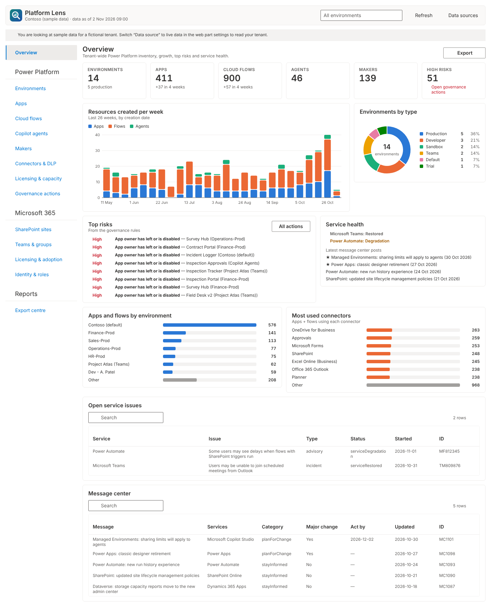

<p></p>

# Platform Lens

A SharePoint Framework (SPFx) web part that gives administrators a **Power Platform admin center
in SharePoint**, with CoE Starter Kit-style inventory and governance dashboards, plus Microsoft 365
dashboards for SharePoint, Teams, licensing and identity. Every page exports to **Excel, PDF
(with charts) and CSV**.

Data is read **live** with the signed-in administrator's delegated permissions: there's no Azure
backend, no Dataverse install and no scheduled sync.



| | |
|---|---|
| Package | [`releases/platform-lens.sppkg`](releases/platform-lens.sppkg) |
| SPFx | 1.21.1 · React 17 · Fluent UI 8 · Node 22 |
| Hosts | SharePoint page (full-width section supported), SharePoint full-page app, Teams tab |
| Modes | **Live** (your tenant) or **Sample** (a fictional tenant for demos, needs no permissions) |

## Dashboards

| Group | Page | What it shows |
|---|---|---|
| Overview | Overview | KPIs, resources created per week (26 weeks), environments by type, top risks, service health, message center |
| Power Platform | Environments | Type, region, Dataverse, Managed Environment, security group, DLP coverage, capacity, resource and maker counts, per-environment load errors |
| | Apps | Canvas and model-driven apps: owner and owner status, connectors, premium use, sharing (**Scan sharing** finds apps shared with everyone), age |
| | Cloud flows | State (on, off, suspended), trigger type, connectors, owner, action count; recent run history in the detail panel |
| | Copilot agents | Copilot Studio agents from every Dataverse environment: publishing, authentication (flags public agents), owner |
| | Makers | Everyone who owns a resource: department, country, status (active, disabled, left), last sign-in, new makers per month |
| | Connectors & DLP | Connector usage by tier (standard, premium, custom), DLP policies, connectors blocked or business-classified, environments with no DLP policy |
| | Licensing & capacity | Power Platform licences (assigned against purchased), unassigned-licence cost from unit prices you enter, Dataverse database, file and log capacity |
| | Governance actions | A worklist from 14 rules (orphaned resources, apps shared with everyone, public agents, environments without DLP or a security group, suspended flows, ownerless groups, expiring app secrets…), each with a recommended action and a deep link |
| Microsoft 365 | SharePoint sites | Site inventory from the usage report: storage, files, page views, external sharing, Anyone links, inactive sites, 90-day storage trend |
| | Teams & groups | Microsoft 365 groups and teams, owner count (flags ownerless and single-owner), privacy, team activity, guests |
| | Licensing & adoption | All SKUs, daily active users per workload (90 days), Microsoft 365 Copilot activity, licensed users inactive for 30 days |
| | Identity & roles | Admin role holders, guests, stale accounts, MFA registration, app registration secrets and certificates by expiry |
| Reports | Export centre | Pick any pages and download one Excel workbook (summary sheet plus a sheet per table), a PDF report pack, or CSVs |

Every grid supports search, sorting, page filters, a click-through detail panel and **CSV of the
current view**. Every page has an **Export** menu (Excel, PDF with the charts on screen, CSV). The
toolbar's **environment filter** applies to all Power Platform pages and exports.

## API permissions

These are requested in `config/package-solution.json` and appear in **SharePoint admin center >
Advanced > API access** after you upload the package. Approve each one.

| Resource | Scope | Used for |
|---|---|---|
| Microsoft Graph | `User.Read.All` | Resolve owners and makers, detect owners who left (orphans), user list |
| Microsoft Graph | `Group.Read.All` | Microsoft 365 groups and teams, owner counts |
| Microsoft Graph | `Organization.Read.All` | Subscribed SKUs (licences) |
| Microsoft Graph | `Reports.Read.All` | SharePoint, Teams, active-user and Copilot usage reports |
| Microsoft Graph | `ReportSettings.Read.All` | Detect hidden (concealed) names in reports and warn |
| Microsoft Graph | `Sites.Read.All` | SharePoint site data |
| Microsoft Graph | `SharePointTenantSettings.Read.All` | Tenant external-sharing level |
| Microsoft Graph | `AuditLog.Read.All` | Last sign-in for makers and users, MFA registration (needs Entra ID P1) |
| Microsoft Graph | `RoleManagement.Read.Directory` | Admin role holders |
| Microsoft Graph | `Application.Read.All` | App registration secrets and certificates nearing expiry |
| Microsoft Graph | `ServiceHealth.Read.All` | Service health and open issues |
| Microsoft Graph | `ServiceMessage.Read.All` | Message center posts |
| PowerApps Service | `User` | Environments, capacity, apps, app sharing, DLP policies (`api.bap.microsoft.com`, `api.powerapps.com`) |
| Microsoft Flow Service | `Flows.Read.All`, `User` | Cloud flow inventory and run history (`api.flow.microsoft.com`) |
| Dynamics CRM | `user_impersonation` | Copilot Studio agents and model-driven apps from each environment's Dataverse |

**Roles the viewer needs.** Delegated permissions never exceed the signed-in user's rights. The
Power Platform pages need the **Power Platform Administrator** (or Dynamics 365 Administrator)
role. The Microsoft 365 pages need **Global Reader**, or a mix of Reports Reader, SharePoint
Administrator and Teams Administrator. The Agents page also needs a Dataverse role in each
environment, which Power Platform administrators can assign to themselves. Put the web part on a
page that only administrators can open.

> **Tenant-wide grant.** SPFx permission approvals are granted to the tenant's shared
> "SharePoint Online Web Client Extensibility" principal, so any SPFx code in the tenant can use
> them. This is how SPFx works and is why the plan recommended an Azure-hosted collector as the
> more locked-down alternative. Only approve these if you control which SPFx solutions are
> deployed in your tenant.

If a resource name is shown as "not found" when you approve (some tenants list *Dynamics CRM* as
*Dataverse*), approve the others; the **Data sources** panel shows exactly which pages are affected.

## Deploy

1. Upload `releases/platform-lens.sppkg` to the **tenant app catalog** and choose
   **Deploy** (tenant-wide deployment is enabled, so no per-site install is needed).
2. In **SharePoint admin center > Advanced > API access**, approve the pending requests.
3. Create a page on an admin-only site, add a full-width section, and add **Platform Governance
   Hub** (in the *Advanced* group).
4. Open **Data sources** in the dashboard toolbar and choose **Check all sources**. Each API shows
   *Working*, *Access denied* (permission not approved or role missing) or *Blocked* (the browser
   could not reach it).

### Web part settings

| Setting | Default | Notes |
|---|---|---|
| Title | Platform Lens | |
| Page to open first | Overview | |
| Data source | Live | *Sample* shows a fictional tenant for demos and training |
| Read Dataverse in each environment | On | Turn off to skip agents and model-driven apps (fewer calls) |
| Maximum rows per user-level list | 50,000 | Cap for users, sites and report rows on very large tenants |

## Branding

| File | Use |
|---|---|
| `assets/logo.svg` | Master logo (lens over rising bars, teal-to-blue tile) |
| `assets/logo-wordmark.svg` | Logo with the product name, for docs and slides |
| `assets/logo-96.png` → `sharepoint/images/AppIcon.png` | App catalog icon (`iconPath` in `package-solution.json`) |
| `assets/logo-40.png` | Web part toolbox icon (embedded as `iconImageUrl` in the manifest) |

The dashboard header and the PDF cover page show the same mark.

## How it works

```
SharePoint page
 └─ Platform Lens web part (React + Fluent UI)
     ├─ LiveDataProvider ── AadHttpClient (tokens issued via SharePoint)
     │    ├─ Microsoft Graph v1.0 / beta (reports as JSON)
     │    ├─ api.bap.microsoft.com / api.powerapps.com   (Power Platform admin)
     │    ├─ api.flow.microsoft.com                       (Power Automate admin)
     │    └─ <org>.crm.dynamics.com/api/data/v9.2         (Dataverse per environment)
     └─ SampleDataProvider (deterministic demo tenant)
```

- **One HTTP client** handles paging (`nextLink` and `@odata.nextLink`), throttling (429/503/504
  with `Retry-After` and exponential backoff), Graph `$batch` for user lookups, and classifies each
  failure so the Data sources panel can explain it.
- **Partial failure is expected and handled.** If one environment or API fails, the rest still
  load; failures are listed on the Environments page and in Data sources, and are included in the
  export.
- **Results are cached** per browser session; **Refresh** reloads everything.
- **Exports run in the browser.** ExcelJS and jsPDF load on demand in separate bundle chunks, so
  they don't slow the first load. CSV cells are escaped against formula injection. Nothing is sent
  to any other service.

## Limits to know about

- **No history.** Admin APIs return the current state. Trends are derived from creation dates
  (for example "resources created per week"); usage telemetry such as *app launches* lives in the
  audit log, which a browser-only solution can't read. That needs a backend collector, as the
  CoE Starter Kit uses.
- **Power Platform admin endpoints and CORS.** The `api.bap`, `api.powerapps` and `api.flow`
  admin endpoints are the ones Microsoft's own admin tools call, but Microsoft doesn't document
  them for third-party single-page apps. They could not be tested from the build environment.
  If your tenant's browsers can't reach them, Data sources shows *Blocked*, and the Microsoft 365
  pages keep working.
- **"Shared with everyone"** needs one request per canvas app, so it runs only when you click
  **Scan sharing** (six requests at a time).
- **Concealed report names.** If *Display concealed user, group, and site names in all reports*
  is on, usage reports show hashes; the dashboard warns you on the affected pages.
- **Managed model-driven apps** installed by Microsoft or ISV solutions are not counted.

## Develop

```bash
npm install
npm run typecheck   # TypeScript, strict null checks
npm run lint        # ESLint (SPFx React profile), zero warnings allowed
npm test            # unit tests: API mapping, paging/retry, governance rules, CSV/Excel helpers
npm run release     # clean ship build + package, copies the .sppkg into releases/
```

Use `gulp serve` with the hosted workbench (`https://<tenant>.sharepoint.com/_layouts/workbench.aspx`),
and set **Data source** to *Sample* to work without permissions.

### Quality gate used for this release

- `tsc` and ESLint clean (0 errors, 0 warnings); 16 unit tests pass.
- `gulp bundle --ship` and `gulp package-solution --ship` succeed; the package was unzipped and
  checked for the manifest, the feature and all 16 permission requests.
- All 14 pages rendered in headless Chromium with sample data, in light and dark themes and at
  phone width, with no runtime errors or horizontal overflow. The detail panels, filters,
  environment filter, sharing scan, flow run history, Data sources panel, page exports (Excel,
  PDF, CSV) and Export centre (Excel, PDF) were exercised and the output files validated.
- Not tested: live calls against a real tenant (the build environment has no tenant access).

## Source layout

```
src/webparts/platformHub/
  PlatformHubWebPart.ts        web part, property pane, AadHttpClient transport, theme
  app/http/ApiClient.ts        paging, retry/throttling, error classification
  app/services/                Graph, Power Platform admin and Dataverse calls + mapping
  app/providers/               Live and Sample providers, caching, data-source diagnostics
  app/logic/                   governance rules, connectors, SKUs, aggregation, formatting
  app/export/                  CSV, Excel (ExcelJS), PDF (jsPDF), chart PNG capture
  app/ui/                      app shell, pages, grid, charts, panels
tests/                         unit tests (node:test, bundled with esbuild)
```
